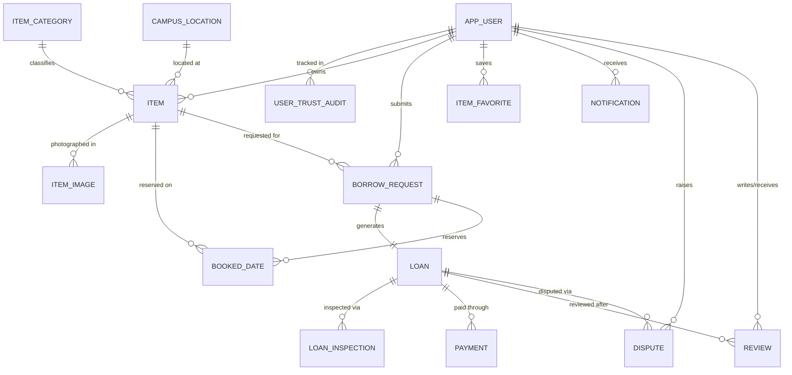

# BorrowHub — Database Architecture & Schema Design

**Target RDBMS:** MySQL 8.0.16+ with InnoDB Storage Engine  
**Character Set:** `utf8mb4` with `utf8mb4_0900_ai_ci` Collation  
**Master Schema File:** `database/schema.sql`  
**Seed Data File:** `database/seed.sql`

---

## 1. Entity-Relationship (ER) Diagram

---

## 2. Relational Table Dictionary

### 2.1 Core User & Trust Tables
* **`APP_USER`**: Core student identity table.
  - `user_id` (INT PK Auto-Increment)
  - `svnit_email` (VARCHAR(191) UNIQUE, NOT NULL): Enforced by check constraint `chk_user_email` to end in `@svnit.ac.in` or `@coed.svnit.ac.in`.
  - `password_hash` (VARCHAR(255), NOT NULL): Bcrypt encrypted digest.
  - `full_name` (VARCHAR(120), NOT NULL)
  - `roll_number` (VARCHAR(32), NOT NULL)
  - `phone_number` (VARCHAR(20), NULL)
  - `role` (ENUM: `'STUDENT'`, `'FACULTY'`, `'MODERATOR'`, `'ADMIN'`)
  - `trust_score` (DECIMAL(5,2), DEFAULT 100.00): Bounded by `chk_trust_score` between 0.00 and 100.00.
  - `is_active` (TINYINT(1), DEFAULT 1)
  - `email_verified` (TINYINT(1), DEFAULT 0)
  - `verification_token_hash` (VARCHAR(64), NULL)
  - `verification_expires_at` (DATETIME, NULL)
  - `created_at`, `updated_at` (TIMESTAMP)

* **`USER_TRUST_AUDIT`**: Append-only log of student trust score changes.
  - `audit_id` (BIGINT PK Auto-Increment)
  - `user_id` (INT FK -> `APP_USER.user_id`)
  - `delta` (DECIMAL(5,2), NOT NULL)
  - `reason` (VARCHAR(255), NOT NULL)
  - `previous_score`, `new_score` (DECIMAL(5,2))
  - `created_at` (TIMESTAMP)

### 2.2 Catalog & Listing Tables
* **`ITEM_CATEGORY`**: Pre-configured categories (Electronics, Books, Lab Equipment, Sports, Tools, Stationery, Musical Instruments, Others).
* **`CAMPUS_LOCATION`**: Pre-configured physical locations across SVNIT campus.
* **`ITEM`**: Resource listings available for borrowing.
  - `item_id` (INT PK Auto-Increment)
  - `owner_id` (INT FK -> `APP_USER.user_id`, CASCADE)
  - `category_id` (INT FK -> `ITEM_CATEGORY.category_id`)
  - `location_id` (INT FK -> `CAMPUS_LOCATION.location_id`, NULLABLE)
  - `custom_location` (VARCHAR(120), NULL): Used if location is outside predefined spots.
  - `title` (VARCHAR(160), NOT NULL)
  - `description` (TEXT, NULL)
  - `item_condition` (ENUM: `'NEW'`, `'GOOD'`, `'FAIR'`, `'WORN'`, `'DAMAGED'`)
  - `deposit_amount` (DECIMAL(10,2), NOT NULL >= 0.00)
  - `daily_fee` (DECIMAL(10,2), NOT NULL >= 0.00)
  - `max_borrow_days` (INT, DEFAULT 14, BETWEEN 1 AND 90)
  - `listing_status` (ENUM: `'ACTIVE'`, `'PAUSED'`, `'ARCHIVED'`)
* **`ITEM_IMAGE`**: Cloudinary image metadata and URLs.
  - `image_id` (INT PK Auto-Increment)
  - `item_id` (INT FK -> `ITEM.item_id`, CASCADE)
  - `image_url` (VARCHAR(512), NOT NULL)
  - `storage_asset_id` (VARCHAR(255), NULL)
  - `is_primary` (TINYINT(1), DEFAULT 0)
  - `sort_order` (TINYINT, DEFAULT 0)
* **`ITEM_FAVORITE`**: Many-to-many saved resources per student.

### 2.3 Borrowing & Loan Lifecycle Tables
* **`BORROW_REQUEST`**: Student booking intent with independent fee snapshots.
  - `request_id` (INT PK Auto-Increment)
  - `item_id` (INT FK -> `ITEM.item_id`)
  - `borrower_id` (INT FK -> `APP_USER.user_id`)
  - `start_date` (DATE, NOT NULL)
  - `end_date` (DATE, NOT NULL, >= `start_date`)
  - `daily_fee_snapshot` (DECIMAL(10,2), NOT NULL)
  - `deposit_snapshot` (DECIMAL(10,2), NOT NULL)
  - `status` (ENUM: `'PENDING'`, `'APPROVED'`, `'REJECTED'`, `'CANCELLED'`)
  - `request_message` (TEXT, NULL)
  - `decision_note` (TEXT, NULL)
  - `decided_at` (DATETIME, NULL)
  - `created_at` (TIMESTAMP)

* **`BOOKED_DATE`**: Concurrency protection table storing individual reserved dates per item.
  - Composite Unique Key: `(item_id, booked_date)` — Guarantees database-level immunity against double-booking races.

* **`LOAN`**: Active resource loan contract.
  - `loan_id` (INT PK Auto-Increment)
  - `request_id` (INT UNIQUE FK -> `BORROW_REQUEST.request_id`)
  - `status` (ENUM: `'SCHEDULED'`, `'ACTIVE'`, `'RETURNED'`, `'CANCELLED'`, `'OVERDUE'`)
  - `agreed_daily_fee`, `agreed_deposit`, `agreed_total_fee` (DECIMAL(10,2))
  - `deposit_status` (ENUM: `'PENDING'`, `'HELD'`, `'PARTIALLY_REFUNDED'`, `'REFUNDED'`, `'FORFEITED'`)
  - `handover_otp_hash` (CHAR(64), NULL): Cryptographic SHA-256 hash.
  - `return_otp_hash` (CHAR(64), NULL): Cryptographic SHA-256 hash.
  - `issued_at`, `due_date`, `returned_at` (DATETIME)

* **`LOAN_INSPECTION`**: Verification audit of physical item handshakes.
  - `inspection_id` (INT PK Auto-Increment)
  - `loan_id` (INT FK -> `LOAN.loan_id`)
  - `stage` (ENUM: `'HANDOVER'`, `'RETURN'`)
  - `inspection_status` (ENUM: `'PENDING'`, `'VERIFIED'`, `'FAILED'`, `'DISPUTED'`)
  - `inspector_id` (INT FK -> `APP_USER.user_id`)
  - `inspected_condition` (ENUM)

### 2.4 Financial, Trust & Platform Tables
* **`PAYMENT`**: Records all Razorpay orders, signatures, refunds, and cash settlements.
* **`REVIEW`**: Verified two-sided peer reviews (1-5 stars) created only after `RETURNED`.
* **`DISPUTE`**: Moderation cases with reason, claimed amounts, and admin resolution.
* **`NOTIFICATION`**: Real-time student alerts for approvals, OTP codes, and reminders.
* **`AUDIT_LOG`**: Immutable audit trail of system events.

---

## 3. Database Triggers & Stored Procedures

The database utilizes 23 native triggers and stored procedures to enforce core business logic at the SQL layer:

1. **`trg_borrow_request_bi`**: Enforces that `borrower_id != item.owner_id` and checks that start date is today or later.
2. **`trg_inspection_bi`**: Enforces that `HANDOVER` inspection cannot take place before `start_date`, and verifies that agreed rental fees are `COMPLETED` and deposit is `HELD`.
3. **`trg_inspection_au`**: Automatically updates `LOAN.status` to `'ACTIVE'` when handover inspection is verified, and `'RETURNED'` when return inspection is verified.
4. **`trg_loan_bu`**: Prevents manual status spoofing; transitions to `ACTIVE` and `RETURNED` require verified inspection records.
5. **`trg_payment_bi`**: Enforces strict financial integrity: `RENTAL_FEE` payments must match `loan.agreed_total_fee`, and `DEPOSIT` payments must match `loan.agreed_deposit`.
6. **`sp_approve_request`**: Atomically validates date availability, generates booked dates, and initializes the loan.
7. **`sp_confirm_inspection`**: Validates the SHA-256 hash of the submitted OTP against `loan.handover_otp_hash` or `loan.return_otp_hash`.
8. **`sp_settle_deposit`**: Computes damage and late fee deductions and updates deposit status to `REFUNDED` or `PARTIALLY_REFUNDED`.
